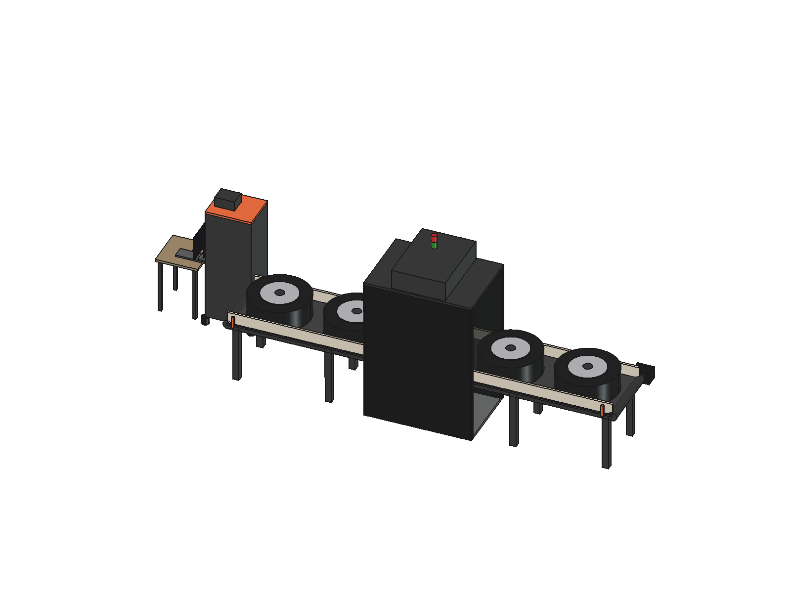
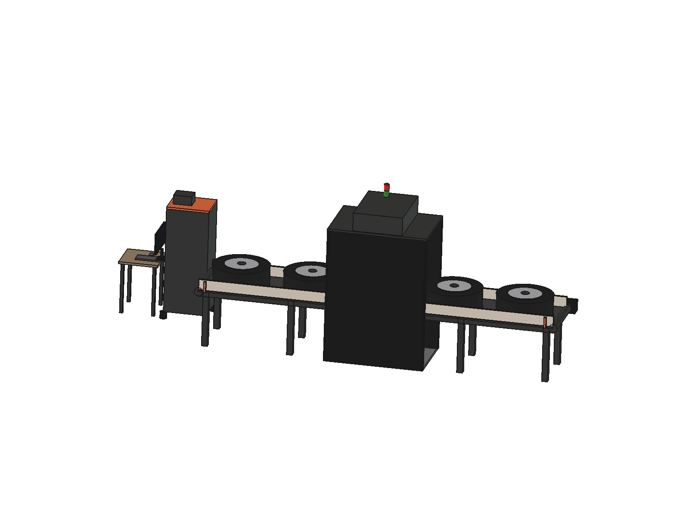
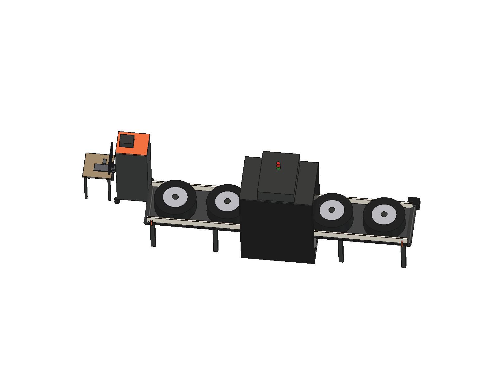

# Machine-Vision Tire/Wheel Identification Conveyor

A concept design for a warehouse-entry conveyor that reads tire brand, size, and
DOT code off a moving wheel — no stopping, no manual scanning.

## The brief, as it actually arrived

Two numbers: maximum wheel envelope (diameter × width) and the conveyor's belt
length. That's it. No read-speed target, no word on what system the identified
data needed to feed into, no site electrical details, no firm deadline.

That's a normal starting point for industrial equipment quoting — the client
knows the problem, not yet the full spec. The question is what you do with it.

## My approach

I don't wait for a complete spec before producing something concrete. I turn
the two known numbers into a full engineering proposal fast, and I'm explicit
about which parts are **confirmed** and which are **my engineering judgment,
open to correction**:

- Confirmed: wheel envelope, belt length.
- My call, stated as such: single-motor belt (no stop/rotate needed — reading
  a rolling wheel from directly overhead is enough for a logo/size/DOT read),
  a light-sealed cabin instead of a partial shroud (consistent exposure matters
  more for OCR than for a human), one overhead camera with diffuse lighting
  rather than multiple angles (the readable text is on top when the tire is laid
  flat), a mobile control panel instead of a fixed one (site electrical
  conditions weren't known yet, so don't commit to a wall-mounted position).

That turns an underspecified request into something the client can react to
immediately — confirm it, or correct exactly the assumption that's wrong —
instead of a back-and-forth that stalls on missing information. The 3D concept
was modeled and rendered the same day the brief came in.

## Technical solution

| | |
|---|---|
| Conveying | Single-motor belt, wheel passes flat, no stop or rotation |
| Read station | Floor-standing light-sealed cabin/tunnel — blocks all outside light |
| Camera | 1 overhead industrial camera + diffuse LED ring light |
| Read target | Brand logo + size text + DOT code (top-facing sidewall) |
| Control | Mobile electrical panel — VFD, start/stop, e-stop |
| Operator display | 24" industrial monitor at the conveyor head, panel-mounted |
| Data capture | Panel-mounted industrial mini PC |
| Status signal | 2-color (red/green) stack light on the cabin |

## System flow

1. Wheel is placed flat on the conveyor belt at the entry point
2. Single-motor belt carries it into the light-sealed cabin at constant speed
3. Wheel passes through without stopping or rotating; an entry sensor triggers the camera
4. Overhead camera captures the image/image sequence during the pass
5. Vision software reads brand, size, and DOT code
6. Result appears immediately on the operator display and the inventory record
7. Wheel continues on the belt into the facility

  
  

## About

Mechanical design engineer (SolidWorks, 11 years, 100+ projects).

## License

MIT — reuse the write-up and the approach. The renders are mine; ask before reuse.
